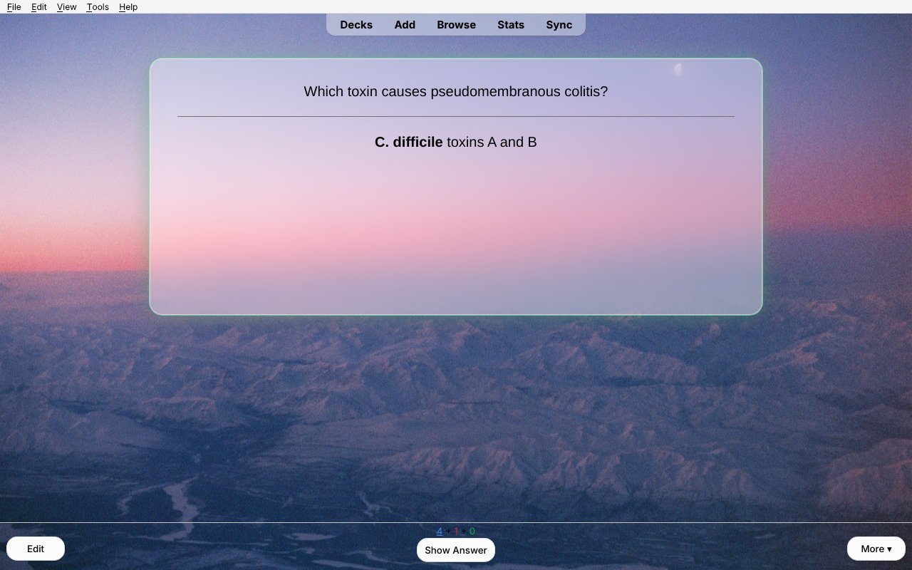
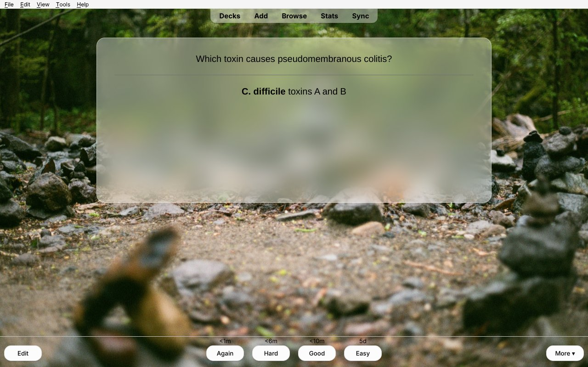
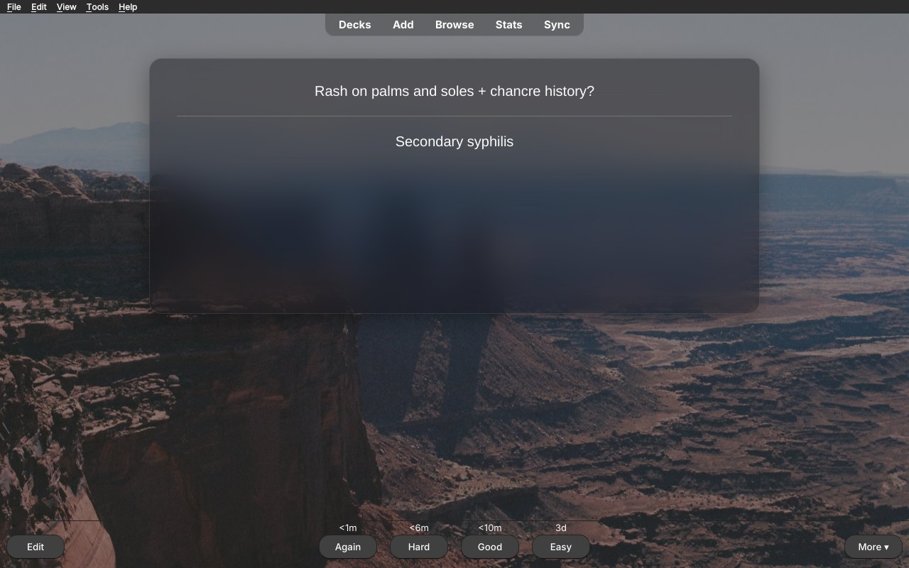
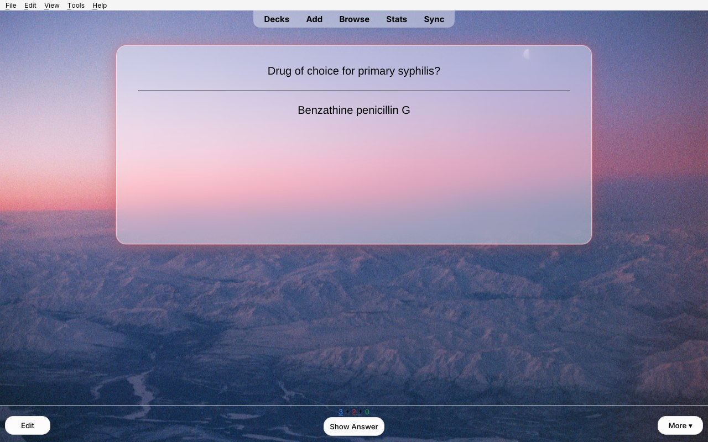
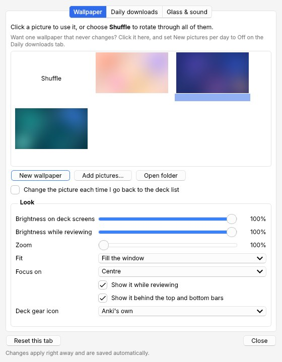
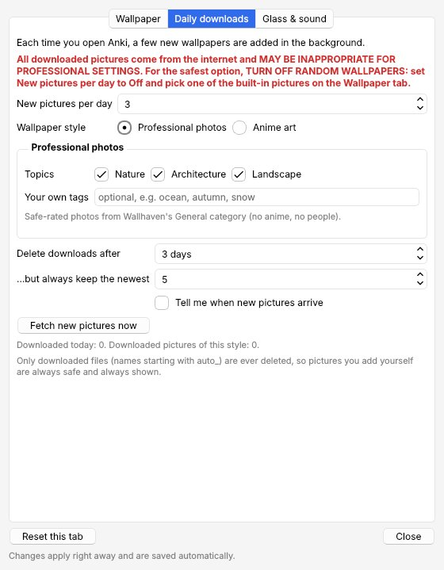
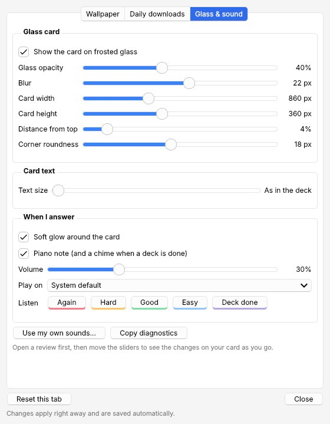

# Frosted Glass: Anki Aesthetic Overhaul

A calm, good-looking Anki. Your cards sit on a pane of frosted glass over a wallpaper that runs behind every screen, and each answer gets a soft glow and a quiet piano note.



## Features

- **Wallpaper behind every screen**: the deck list, deck overview, review screen and the top and bottom bars. The picture lines up seamlessly across all three areas, in light and dark mode.
- **New wallpapers every day**, in the style you choose:
  - **Professional photos** from [Wallhaven](https://wallhaven.cc)'s General category (no anime, no people), on the topics Nature, Architecture and Landscape, plus any tags you type in yourself.
  - **Anime art** from Konachan and Wallhaven, safe-rated pictures only.
  - Or turn downloads off and keep one picture forever. Four built-in wallpapers are included, and you can add your own.
- **Frosted-glass card** with adjustable opacity, blur, width, height, position and corner roundness. Cards keep a steady size, and longer cards grow smoothly.
- **Answer feedback**: a soft glow in the answer's color, plus a short piano note (Again, Hard, Good and Easy each have their own), and a soft chime when you finish a deck. You can adjust the volume, pick which speakers or headphones play it, or turn either off, and use your own sounds if you like.
- **Card text size** slider. It changes only the size; bold, colors and links stay as they are.
- **New wallpaper** button on the deck list, and **Ctrl+Shift+W** anywhere.
- **Custom deck gear icons** (optional).
- One **Settings** window. Every change shows up live without reloading.

| Light mode | Dark mode |
|---|---|
|  |  |

| Glow on Good | Glow on Again |
|---|---|
|  |  |

## Install

**From AnkiWeb (recommended):** in Anki, go to Tools → Add-ons → Get Add-ons… and paste the code from the [AnkiWeb page](https://ankiweb.net/shared/addons). Then restart Anki.

**From a file:** download `frosted_glass_theme.ankiaddon` from the [latest release](https://github.com/aidansun525/liquid-glass-anki-theme/releases/latest). Then go to Tools → Add-ons → Install from File… and restart Anki.

Updating keeps your settings and pictures. If you switch between installing from a file and installing from AnkiWeb, the copy you install last brings over everything from the other one and turns the other one off. You can then delete the old copy from Tools → Add-ons.

It needs Anki 2.1.50 or newer and works on Windows, macOS and Linux.

## Using it

Open **Tools → Frosted Glass → Settings…**.

| Wallpaper | Daily downloads | Glass & sound |
|---|---|---|
|  |  |  |

- **Wallpaper**: click a picture to keep it, or choose *Shuffle*. *Add pictures…* copies your own pictures in. You can also adjust brightness, zoom and fit here.
- **Daily downloads**: choose how many new pictures you get each day (or *Off*), the style (Professional or Anime), and which topics or sites to use. Downloads are deleted after a few days, but the newest few are always kept. Pictures you add yourself are never deleted.
- **Glass & sound**: the glass card, text size, glow, piano note and volume.

**Want a wallpaper that never changes?** Click it on the Wallpaper tab, then set *New pictures per day* to *Off*.

### ⚠️ About downloaded pictures

**All downloaded pictures come from the internet and MAY BE INAPPROPRIATE FOR PROFESSIONAL SETTINGS.** Only pictures rated "safe" are downloaded, but that rating depends on how each uploader labeled their picture. **For the safest option, TURN OFF RANDOM WALLPAPERS:** set *New pictures per day* to *Off* and pick one of the built-in pictures. The Settings window always shows this warning.

## Coming from other add-ons

On first launch, it imports your pictures, gear icons and settings from **Custom Background Image and Gear Icon** (AnKing). It then turns that add-on off so the two don't both draw backgrounds. The old add-on's folder stays in place, so you can remove it from Tools → Add-ons.

## Your files

Everything you add or change lives in the add-on's `user_files` folder (Tools → Frosted Glass → Open add-on files folder) and is kept across updates:

- `background/`: wallpapers. Drop in any `.jpg`, `.png` or `.webp`.
- `gear/`: deck gear icons.
- `glass_sounds/`: put `again.wav`, `hard.wav`, `good.wav`, `easy.wav` or `finish.wav` (deck done) here to use your own sounds.
- `css/custom_*.css`: extra CSS for each screen, if you want to go further.

## Building from source

```
python build.py
```

This writes `dist/frosted_glass_theme.ankiaddon` from `src/frosted_glass_theme`. To try changes, copy or link `src/frosted_glass_theme` into Anki's `addons21` folder and restart Anki.

## Credits and license

- Copyright © 2026 AidanS. Licensed under the [GNU Affero General Public License v3.0 or later](LICENSE).
- The background code is based on [Custom Background Image and Gear Icon](https://github.com/AnKing-VIP/Custom-background-image-and-gear-icon) by ijgnd and The AnKing (AGPL-3.0).
- Gear icons are from [Noto Color Emoji](https://github.com/googlefonts/noto-emoji) (Apache 2.0).
- Downloaded wallpapers come from [Wallhaven](https://wallhaven.cc) and [Konachan](https://konachan.net). They belong to their creators and are downloaded to your own computer for personal use as wallpapers.
- The piano notes were made for this add-on.

## Also by me: Card Read Aloud 🎧

Want your cards read to you? **[Card Read Aloud](https://ankiweb.net/shared/info/1243350003)** reads your reviews aloud in a natural, gentle voice (Kokoro). It runs offline on your own computer and is made for med students: it says "I V", not "Roman four", and knows 1,400+ medical pronunciations.

---

<sub>📷 Photo credit for the built-in wallpapers: **Aidan S.**</sub>
