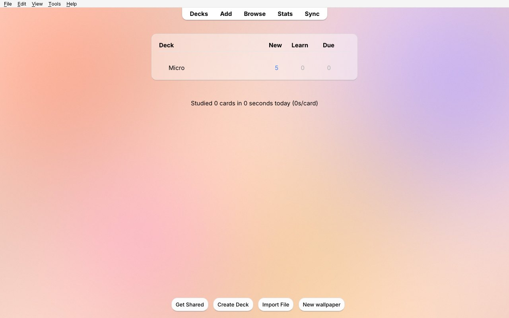

# Frosted Glass: Anki Aesthetic Overhaul

A calm, good-looking Anki. Your cards sit on a pane of frosted glass over a wallpaper that runs behind every screen, and each answer gets a soft glow and a quiet piano note.


## Features

- **Wallpaper behind every screen**: the deck list, deck overview, review screen and the top and bottom bars. The picture lines up seamlessly across all three areas, in light and dark mode.
- **New wallpapers every day**, in the style you choose:
  - **Professional photos** from [Unsplash](https://unsplash.com), on any of five topics: Nature, Travel, Minimal, Animals, or Other (anything).
  - **Anime art** from Konachan and Wallhaven, safe-rated pictures only.
  - Or turn downloads off and keep one picture forever. Three built-in wallpapers are included, and you can add your own.
- **Frosted-glass card** with adjustable opacity, blur, width, height and corner roundness. Cards keep a steady size, and longer cards grow smoothly.
- **Answer feedback**: a soft glow in the answer's color, plus a short piano note (Again, Hard, Good and Easy each have their own). You can adjust the volume or turn either off, and use your own sounds if you like.
- **Card text size** slider. It changes only the size; bold, colors and links stay as they are.
- **New wallpaper** button on the deck list, and **Ctrl+Shift+W** anywhere.
- **Custom deck gear icons** (optional).
- One **Settings** window. Every change shows up live without reloading.

| Deck list | Dark mode |
|---|---|
|  |  |

| Glow on Good | Glow on Again |
|---|---|
|  |  |

## Install

**From AnkiWeb (recommended):** in Anki, go to Tools → Add-ons → Get Add-ons… and paste the code from the [AnkiWeb page](https://ankiweb.net/shared/addons). Then restart Anki.

**From a file:** download `frosted_glass_theme.ankiaddon` from the [latest release](https://github.com/aidansun525/liquid-glass-anki-theme/releases/latest). Then go to Tools → Add-ons → Install from File… and restart Anki.

It needs Anki 2.1.50 or newer and works on Windows, macOS and Linux.

## Using it

Open **Tools → Frosted Glass → Settings…**.

| Wallpaper | Daily downloads | Glass & sound |
|---|---|---|
|  |  |  |

- **Wallpaper**: click a picture to keep it, or choose *Shuffle*. *Add pictures…* copies your own pictures in. You can also adjust brightness, zoom and fit here.
- **Daily downloads**: choose how many new pictures you get each day (or *Off*), the style (Professional or Anime), and which topics or sites to use. Downloads are deleted after a few days, but the newest few are always kept. Pictures you add yourself are never deleted.
- **Glass & sound**: the glass card, text size, glow, piano note and volume.

**Want a wallpaper that never changes?** Click it on the Wallpaper tab, then set *New pictures per day* to *Off*.

### About the anime style

Anime art comes from community sites, and only pictures their uploaders rated "safe" are downloaded. That rating depends on how each uploader labeled their picture, so some may still not suit school, work or other professional settings. The Settings window shows this warning when you choose the anime style. If that matters to you, stick with Professional photos.

### Unsplash photos

Photos are shown directly from Unsplash, and the photographer is credited in a small corner of the deck list while their photo is on screen, as [Unsplash's guidelines](https://help.unsplash.com/en/articles/2511245-unsplash-api-guidelines) ask. If downloads ever stop because the add-on's shared Unsplash key is busy, create a free key at [unsplash.com/developers](https://unsplash.com/developers) and paste its Access Key into Settings → Daily downloads.

## Coming from other add-ons

On first launch, it imports your pictures, gear icons and settings from **Custom Background Image and Gear Icon** (AnKing). It then turns that add-on off so the two don't both draw backgrounds. The old add-on's folder stays in place, so you can remove it from Tools → Add-ons.

## Your files

Everything you add or change lives in the add-on's `user_files` folder (Tools → Frosted Glass → Open add-on files folder) and is kept across updates:

- `background/`: wallpapers. Drop in any `.jpg`, `.png` or `.webp`.
- `gear/`: deck gear icons.
- `glass_sounds/`: put `again.wav`, `hard.wav`, `good.wav` or `easy.wav` here to use your own sounds.
- `css/custom_*.css`: extra CSS for each screen, if you want to go further.

## Building from source

```
python build.py
```

This writes `dist/frosted_glass_theme.ankiaddon` from `src/frosted_glass_theme`. To try changes, copy or link `src/frosted_glass_theme` into Anki's `addons21` folder and restart Anki.

## Credits and license

- Copyright © 2026 AidanS. Licensed under the [GNU Affero General Public License v3.0 or later](LICENSE).
- The background code is based on [Custom Background Image and Gear Icon](https://github.com/AnKing-VIP/Custom-background-image-and-gear-icon) by ijgnd and The AnKing (AGPL-3.0).
- Gear icons are from [Noto Color Emoji](https://github.com/googlefonts/noto-emoji) (Apache 2.0).
- Photos are from [Unsplash](https://unsplash.com/?utm_source=frosted_glass_anki&utm_medium=referral), credited to each photographer and used under the [Unsplash License](https://unsplash.com/license).
- Anime art is from [Konachan](https://konachan.net) and [Wallhaven](https://wallhaven.cc). It belongs to its artists and is downloaded for personal use as a wallpaper.
- The built-in wallpapers and piano notes were made for this add-on.
